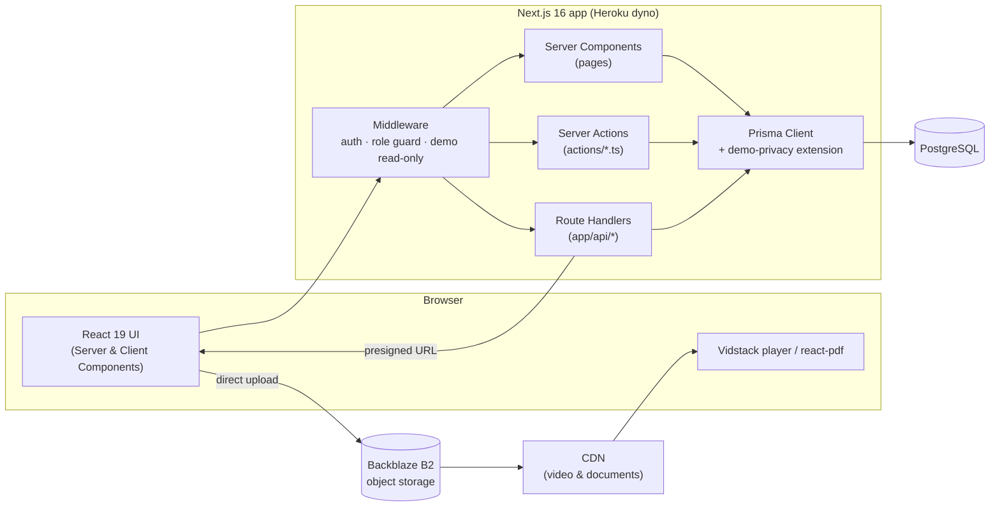

# eClass — Learning Management System

**English** | [Tiếng Việt](README.vi.md)

eClass is a full-stack Learning Management System (LMS) for online teaching. It covers course management, video lessons, interactive assessments with automated grading, learning-progress tracking, and student performance analytics.

The project began as a three-member graduation project at the Posts and Telecommunications Institute of Technology (PTIT) in 2025. It was later extended into a production platform, **[teacherduc.me](https://teacherduc.me)**, which serves real students.

## Project Highlights

- **Production application:** [https://teacherduc.me](https://teacherduc.me), in daily use by real students.
- **Tech stack:** Next.js 16 (App Router, Server Actions), React 19, TypeScript, PostgreSQL, Prisma ORM, Backblaze B2 + CDN.
- **Core features:** course and lesson management, video learning, a test builder with several question types, automated and manual grading, progress tracking, weekly leaderboards, and analytics with Excel export.
- **Demo access:** a restricted, read-only demo account with pseudonymized student data is available to academic reviewers and recruiters on request.

<!-- TODO: add a verifiable usage metric, e.g. "~N weekly active students (MM/YYYY – MM/YYYY)". -->

---

## Table of Contents

1. [Project Background & Contributions](#project-background--contributions)
2. [Screenshots](#screenshots)
3. [System Architecture](#system-architecture)
4. [Key Features](#key-features)
5. [Engineering Challenges & Solutions](#engineering-challenges--solutions)
6. [Technology Stack](#technology-stack)
7. [Getting Started](#getting-started)
8. [Database & Deployment](#database--deployment)
9. [Security & Demo Access](#security--demo-access)
10. [Future Improvements](#future-improvements)

---

## Project Background & Contributions

The first version of the LMS was built as a team graduation project at PTIT, supervised by Mr. Nguyen Manh Son. After graduation, the platform was developed further and adapted for real-world teaching at [teacherduc.me](https://teacherduc.me).

<!--
TODO (author): document individual contributions and keep the two phases separate:

### Graduation project (2025, team of 3)
- My role: ...
- Features / modules I implemented: ...

### Post-graduation development (independent)
- Production deployment and operation (Heroku, PostgreSQL, B2/CDN)
- ...
-->

---

## Screenshots

<!--
TODO: add screenshots to docs/screenshots/ and reference them here, e.g.
| Course page | Test builder | Leaderboard |
|---|---|---|
|  |  |  |
-->

_Screenshots will be added soon. You can explore the live application at [teacherduc.me](https://teacherduc.me)._

---

## System Architecture



- **Rendering:** pages are Server Components that query PostgreSQL through Prisma. Mutations go through Server Actions, and file uploads and Excel exports go through Route Handlers.
- **Auth:** NextAuth v5 (JWT sessions) with Credentials, Google and Facebook providers. Middleware enforces route access by role (`STUDENT`, `TEACHER`, `ADMIN`).
- **Media:** large files are uploaded straight from the browser to B2 using presigned URLs and are served through a CDN, so video traffic does not pass through the application server.

---

## Key Features

**Students**
- Course → chapter → lesson structure with video, PDF and quiz lessons, plus progress tracking.
- Homework and exams with multiple-choice, true/false, multi-statement groups, short-answer and essay questions.
- Draft autosave while taking a test, then results, answer review and attempt history.
- Weekly leaderboard showing rank movement (up, down, new, returning).
- Lesson comments and notifications.

**Teachers**
- Course builder with drag-and-drop ordering and course duplication.
- **Test builder** with sections and multi-part questions, plus a reusable question bank.
- Video library: direct upload to B2 and library synchronization.
- Homework grading, essay grading, and per-test and per-student analytics.

**Administrators**
- User, class and enrollment management.
- System-wide analytics, Excel exports (score matrix, offline reports) and bulk re-grading.

---

## Engineering Challenges & Solutions

| Challenge | Solution |
|---|---|
| **Race between draft autosave and final submission.** A late autosave request could overwrite a submitted attempt. | Submission runs inside a database transaction that locks the attempt row with `SELECT … FOR UPDATE` and rejects any write once `completedAt` is set. |
| **Large video and PDF uploads** on a dyno with limited memory and request timeouts. | The server issues short-lived (15 min) **presigned URLs** and the browser uploads directly to B2. Files go to a `temp/` prefix first and are *committed* (copied to their final key) only when the lesson is saved, which avoids orphaned files. |
| **A fair weekly leaderboard.** Students with only a few lucky tests should not top the board. | Ranking combines academic score, completion and activity bonuses, requires a minimum number of tests, and breaks ties by academic evidence. Weeks are computed in the `Asia/Ho_Chi_Minh` timezone, and weekly **snapshots** are stored so rank changes can be shown. |
| **Leaderboard query cost.** It aggregates attempts for every student in a class. | The base data is cached with `unstable_cache`, and per-user computation (current rank, personal context) runs on top of the shared cache. |
| **Giving reviewers access to a live system without exposing real student data.** | A read-only demo role, enforced in the backend at three layers (middleware, Server Actions, and a Prisma Client extension that pseudonymizes personal data). See [Security & Demo Access](#security--demo-access). |
| **Running a Next.js standalone build on Heroku.** | `output: "standalone"` plus a post-build step (`copy-assets.js`) that copies `public/` and `.next/static` into the standalone bundle. Prisma migrations run in Heroku's release phase. |

---

## Technology Stack

| Area | Technology |
|---|---|
| Framework | Next.js 16 (App Router, Server Actions, `standalone` output) |
| UI | React 19, Tailwind CSS 4, Radix UI, lucide-react, sonner |
| Forms & validation | react-hook-form, zod |
| Auth | NextAuth v5 (Credentials, Google, Facebook) + Prisma Adapter |
| Database | PostgreSQL + Prisma ORM 6 |
| Storage | Backblaze B2 (S3-compatible, AWS SDK v3) + CDN |
| Media | Vidstack (video player), react-pdf |
| Charts & export | Recharts, ExcelJS |
| Deployment | Heroku (Node.js buildpack); Docker setup included |

### Project structure

```
.
├── actions/          # Server Actions (course, test, homework, ranking, user, ...)
├── app/              # Next.js App Router
│   ├── admin/        # Admin pages
│   ├── teacher/      # Teacher pages (courses, tests, videos, homework)
│   ├── courses/      # Course catalog & details
│   ├── watch/        # Lesson player (video / document / quiz)
│   ├── tests/        # Test taking
│   ├── ranking/      # Leaderboard
│   └── api/          # Route handlers (upload, videos, exams, analytics, auth, ...)
├── components/       # React components grouped by module
├── hooks/            # Custom React hooks
├── lib/              # Prisma client, B2 client, grading & ranking logic, demo guards
├── prisma/           # schema.prisma + migrations
├── public/           # Static assets
├── scripts/          # Maintenance scripts (run manually)
├── types/            # Shared type declarations
├── auth.ts           # NextAuth configuration
├── middleware.ts     # Route protection by role / demo mode
├── copy-assets.js    # Copies public/ and static/ into the standalone build
├── Procfile          # Heroku process types
└── Dockerfile        # Multi-stage Docker image
```

---

## Getting Started

### Requirements
- Node.js **22+**
- PostgreSQL **15+**
- npm

### Local setup

```bash
git clone https://github.com/TranDuyHai2003/eclass.git
cd eclass

npm install
cp .env.example .env          # fill in real values

npx prisma generate
npx prisma migrate deploy

npm run dev                   # http://localhost:3000
```

> Need a local database only? Run `docker compose up -d postgres`. It exposes PostgreSQL on port `5433`.

### Environment variables

[.env.example](.env.example) lists every variable. The main ones are:

| Variable | Description |
|---|---|
| `DATABASE_URL` | PostgreSQL connection string used by Prisma |
| `AUTH_SECRET` | NextAuth session secret (`npx auth secret`) |
| `AUTH_URL` / `AUTH_TRUST_HOST` | Public base URL; set `true` when running behind a proxy |
| `GOOGLE_*` / `FACEBOOK_*` | OAuth providers (optional) |
| `B2_KEY_ID` / `B2_APP_KEY` / `B2_REGION` / `B2_ENDPOINT` / `B2_BUCKET_NAME` | Backblaze B2 storage |
| `NEXT_PUBLIC_VIDEO_DOMAIN` / `NEXT_PUBLIC_S3_DOMAIN` | Public CDN domains for media and uploads |

### Scripts

| Command | Description |
|---|---|
| `npm run dev` | Start the development server |
| `npm run build` | Production build (standalone) and asset copy |
| `npm start` | Run the build (`node .next/standalone/server.js`) |
| `npm run lint` | Run ESLint |
| `npm run db:push` | Push the Prisma schema to the DB (development only) |

---

## Database & Deployment

- The schema is in `prisma/schema.prisma` and versioned migrations are in `prisma/migrations/`.
- To change the schema, run `npx prisma migrate dev --name <change_name>`.

### Heroku (production)

Production runs at **[teacherduc.me](https://teacherduc.me)** on Heroku with the Node.js buildpack:

1. **Build:** `npm install` → `npm run build`
2. **Release:** `npx prisma migrate deploy` (see `Procfile`)
3. **Web:** `npm start`

Environment variables are managed as Heroku **Config Vars**.

### Docker (optional)

`docker-compose.yml` builds the app image from source and starts it together with PostgreSQL:

```bash
cp .env.example .env    # set DB_USER, DB_PASSWORD, DB_NAME, AUTH_SECRET, B2_*, ...
docker compose up -d --build
```

Inside the Docker network, Compose overrides `DATABASE_URL` so the app connects to the `postgres` service. The container runs `prisma migrate deploy` before starting the server.

---

## Security & Demo Access

A **read-only demo account** is available on request for academic reviewers and recruiters. Credentials are shared privately and are never committed to the repository.

The demo account is an `ADMIN` with `isDemo = true`. It can browse the admin and teacher dashboards, and restrictions are enforced **in the backend**:

1. **Middleware** (`middleware.ts`): any non-`GET/HEAD/OPTIONS` request to `/api/*` (except `/api/auth`) returns `403`. Enrollment and finance pages are also blocked.
2. **Server Actions** (`actions/*.ts`): every mutating action calls `demoGuard()` (`lib/demo.ts`) before doing any work.
3. **Data privacy** (`lib/demo-privacy.ts`): a Prisma Client extension pseudonymizes every `User` record returned to a demo viewer, including records nested in `include`/`select` results (resolved through Prisma DMMF). Student names become stable aliases such as `Học viên 3F9A2C`, and emails and avatars are hidden. Shared caches always hold the original data, and masking is applied per request.

The `isDemo` flag comes from the signed session token and the database, never from client input.

Create the demo account or rotate its password:

```bash
heroku run -a <app> -e "DEMO_EMAIL=<email>" -- node scripts/create-demo-account.js
```

If `DEMO_PASSWORD` is omitted, the script generates a random password. Re-running the command rotates the password and revokes earlier access.

Other practices:
- Secrets live only in environment variables. `.env`, SQL dumps and logs are git-ignored.
- Passwords are hashed with bcrypt.
- Role-based route protection is applied in middleware and re-checked in Server Actions.

---

## Future Improvements

- Automated tests (unit tests for grading and ranking logic, end-to-end tests for test-taking flows) and a CI pipeline.
- Observability: structured logging and error tracking in production.
- Internationalization (the UI is currently in Vietnamese).
- An in-browser practice mode for the demo account, so reviewers can try test-taking without writing to the database.

---

© eClass. All rights reserved.
