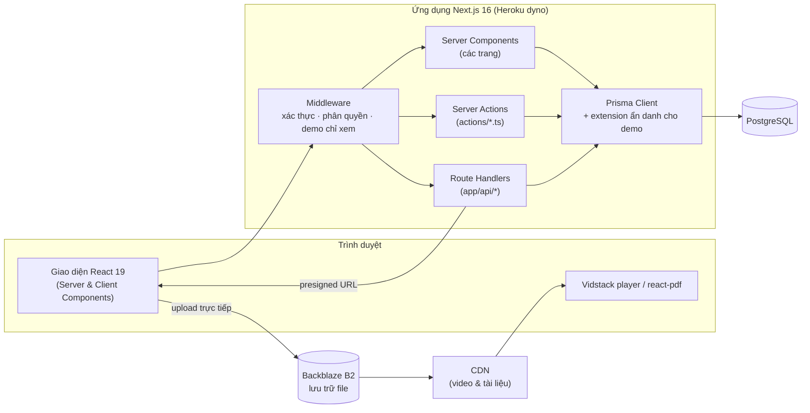

# eClass — Hệ thống quản lý học tập (LMS)

[English](README.md) | **Tiếng Việt**

eClass là nền tảng học trực tuyến full-stack. Hệ thống gồm quản lý khóa học, bài giảng video, bài kiểm tra tương tác có chấm điểm tự động, theo dõi tiến độ học tập và phân tích kết quả học sinh.

Dự án bắt đầu là đồ án tốt nghiệp nhóm 3 người tại Học viện Công nghệ Bưu chính Viễn thông (PTIT) năm 2025. Sau đó, dự án được phát triển tiếp thành nền tảng production **[teacherduc.me](https://teacherduc.me)** và đang phục vụ học sinh thật.

## Điểm nổi bật

- **Website production:** [https://teacherduc.me](https://teacherduc.me), học sinh thật đang sử dụng hằng ngày.
- **Công nghệ:** Next.js 16 (App Router, Server Actions), React 19, TypeScript, PostgreSQL, Prisma ORM, Backblaze B2 + CDN.
- **Chức năng chính:** quản lý khóa học và bài học, học qua video, soạn đề với nhiều dạng câu hỏi, chấm tự động và chấm tay, theo dõi tiến độ, bảng xếp hạng tuần, thống kê và xuất Excel.
- **Tài khoản demo:** có tài khoản chỉ xem, trong đó dữ liệu học sinh đã được ẩn danh. Tài khoản này được cung cấp riêng cho người đánh giá học thuật và nhà tuyển dụng khi có yêu cầu.

<!-- TODO: thêm số liệu người dùng có thể kiểm chứng, ví dụ "~N học sinh hoạt động mỗi tuần (MM/YYYY – MM/YYYY)". -->

---

## Mục lục

1. [Bối cảnh & đóng góp](#bối-cảnh--đóng-góp)
2. [Ảnh chụp màn hình](#ảnh-chụp-màn-hình)
3. [Kiến trúc hệ thống](#kiến-trúc-hệ-thống)
4. [Tính năng](#tính-năng)
5. [Bài toán kỹ thuật & giải pháp](#bài-toán-kỹ-thuật--giải-pháp)
6. [Công nghệ](#công-nghệ)
7. [Bắt đầu](#bắt-đầu)
8. [Database & triển khai](#database--triển-khai)
9. [Bảo mật & tài khoản demo](#bảo-mật--tài-khoản-demo)
10. [Hướng phát triển](#hướng-phát-triển)

---

## Bối cảnh & đóng góp

Phiên bản đầu tiên của hệ thống là đồ án tốt nghiệp nhóm tại PTIT, do thầy Nguyễn Mạnh Sơn hướng dẫn. Sau khi tốt nghiệp, nền tảng tiếp tục được phát triển và đưa vào giảng dạy thực tế tại [teacherduc.me](https://teacherduc.me).

<!--
TODO (tác giả): ghi rõ đóng góp cá nhân, tách riêng hai giai đoạn:

### Đồ án tốt nghiệp (2025, nhóm 3 người)
- Vai trò: ...
- Các module/tính năng tự thực hiện: ...

### Phát triển sau tốt nghiệp (cá nhân)
- Triển khai và vận hành production (Heroku, PostgreSQL, B2/CDN)
- ...
-->

---

## Ảnh chụp màn hình

<!-- TODO: thêm ảnh vào docs/screenshots/ và chèn tại đây. -->

_Ảnh chụp màn hình sẽ được bổ sung sau. Bạn có thể trải nghiệm trực tiếp tại [teacherduc.me](https://teacherduc.me)._

---

## Kiến trúc hệ thống



- **Render:** các trang là Server Components, truy vấn PostgreSQL qua Prisma. Thao tác ghi dữ liệu đi qua Server Actions; upload file và xuất Excel đi qua Route Handlers.
- **Xác thực:** NextAuth v5 (session JWT) với đăng nhập Credentials, Google và Facebook. Middleware phân quyền truy cập theo vai trò (`STUDENT`, `TEACHER`, `ADMIN`).
- **Media:** file lớn được upload thẳng từ trình duyệt lên B2 bằng presigned URL và phân phối qua CDN, nên lưu lượng video không đi qua server ứng dụng.

---

## Tính năng

**Học sinh**
- Học theo cấu trúc khóa học → chương → bài học. Bài học có thể là video, PDF hoặc quiz. Hệ thống lưu tiến độ học.
- Làm bài tập và bài kiểm tra với các dạng câu hỏi: trắc nghiệm, đúng/sai, nhóm nhiều ý, trả lời ngắn và tự luận.
- Bài làm được tự động lưu nháp. Sau khi nộp có thể xem kết quả, đáp án và lịch sử làm bài.
- Bảng xếp hạng tuần hiển thị biến động hạng: lên, xuống, mới vào top, quay lại.
- Bình luận dưới bài học và nhận thông báo.

**Giáo viên**
- Soạn khóa học, kéo-thả để sắp xếp chương/bài và nhân bản khóa học.
- **Test Builder:** soạn đề chia theo phần, có câu hỏi nhiều ý con và ngân hàng đề dùng lại được.
- Thư viện video: upload trực tiếp lên B2 và đồng bộ thư viện.
- Chấm bài tập, chấm tự luận, xem thống kê theo từng bài và từng học sinh.

**Quản trị viên**
- Quản lý người dùng, lớp học và ghi danh.
- Xem thống kê toàn hệ thống, xuất Excel (ma trận điểm, bản offline) và chấm lại hàng loạt.

---

## Bài toán kỹ thuật & giải pháp

| Bài toán | Giải pháp |
|---|---|
| **Xung đột giữa lưu nháp tự động và nộp bài:** một request lưu nháp đến muộn có thể ghi đè bài đã nộp. | Nộp bài chạy trong transaction, khóa dòng bài làm bằng `SELECT … FOR UPDATE` và từ chối ghi khi `completedAt` đã có giá trị. |
| **Upload video/PDF dung lượng lớn** trên dyno bị giới hạn bộ nhớ và thời gian request. | Server cấp **presigned URL** có hạn 15 phút, trình duyệt upload thẳng lên B2. File được đặt trước ở `temp/` và chỉ *commit* (copy sang key chính thức) khi lưu bài học, nhờ đó không để lại file rác. |
| **Bảng xếp hạng tuần công bằng:** không để học sinh chỉ làm vài bài may mắn đứng đầu. | Điểm xếp hạng kết hợp điểm học thuật, thưởng hoàn thành và thưởng hoạt động. Học sinh phải đạt số bài tối thiểu mới được xếp hạng; khi bằng điểm thì ưu tiên năng lực học thuật. Tuần được tính theo múi giờ `Asia/Ho_Chi_Minh`, và **snapshot** hằng tuần được lưu lại để hiển thị biến động hạng. |
| **Chi phí truy vấn xếp hạng cao:** phải tổng hợp bài làm của cả lớp. | Dữ liệu nền được cache bằng `unstable_cache`, phần tính riêng cho từng người dùng chạy trên cache dùng chung. |
| **Cho người đánh giá xem hệ thống thật mà không lộ dữ liệu học sinh.** | Vai trò demo chỉ xem, được thực thi ở backend qua 3 lớp: middleware, Server Actions và Prisma extension ẩn danh dữ liệu. Xem mục [Bảo mật & tài khoản demo](#bảo-mật--tài-khoản-demo). |
| **Chạy bản build standalone của Next.js trên Heroku.** | Dùng `output: "standalone"` kèm bước `copy-assets.js` để copy `public/` và `.next/static` vào bản build. Migration Prisma chạy ở release phase của Heroku. |

---

## Công nghệ

| Hạng mục | Công nghệ |
|---|---|
| Framework | Next.js 16 (App Router, Server Actions, output `standalone`) |
| UI | React 19, Tailwind CSS 4, Radix UI, lucide-react, sonner |
| Form & validate | react-hook-form, zod |
| Xác thực | NextAuth v5 (Credentials, Google, Facebook) + Prisma Adapter |
| Database | PostgreSQL + Prisma ORM 6 |
| Lưu trữ | Backblaze B2 (S3-compatible, AWS SDK v3) + CDN |
| Media | Vidstack (video player), react-pdf |
| Biểu đồ & xuất file | Recharts, ExcelJS |
| Triển khai | Heroku (Node.js buildpack); có sẵn cấu hình Docker |

### Cấu trúc thư mục

```
.
├── actions/          # Server Actions (course, test, homework, ranking, user, ...)
├── app/              # Next.js App Router
│   ├── admin/        # Trang quản trị
│   ├── teacher/      # Trang giáo viên (khóa học, bài kiểm tra, video, bài tập)
│   ├── courses/      # Danh sách & chi tiết khóa học
│   ├── watch/        # Trang học bài (video / tài liệu / quiz)
│   ├── tests/        # Làm bài kiểm tra
│   ├── ranking/      # Bảng xếp hạng
│   └── api/          # Route handlers (upload, videos, exams, analytics, auth, ...)
├── components/       # React components theo module
├── hooks/            # Custom React hooks
├── lib/              # Prisma client, B2 client, logic chấm điểm & xếp hạng, demo guard
├── prisma/           # schema.prisma + migrations
├── public/           # Static assets
├── scripts/          # Script vận hành/bảo trì, chạy thủ công
├── types/            # Khai báo kiểu dùng chung
├── auth.ts           # Cấu hình NextAuth
├── middleware.ts     # Bảo vệ route theo vai trò / chế độ demo
├── copy-assets.js    # Copy public/ và static/ vào bản build standalone
├── Procfile          # Cấu hình process cho Heroku
└── Dockerfile        # Docker image (multi-stage)
```

---

## Bắt đầu

### Yêu cầu
- Node.js **22+**
- PostgreSQL **15+**
- npm

### Cài đặt local

```bash
git clone https://github.com/TranDuyHai2003/eclass.git
cd eclass

npm install
cp .env.example .env          # điền giá trị thật

npx prisma generate
npx prisma migrate deploy

npm run dev                   # http://localhost:3000
```

> Chỉ cần database local? Chạy `docker compose up -d postgres`. PostgreSQL sẽ chạy ở cổng `5433`.

### Biến môi trường

File [.env.example](.env.example) liệt kê đầy đủ các biến. Các biến chính:

| Biến | Mô tả |
|---|---|
| `DATABASE_URL` | Chuỗi kết nối PostgreSQL cho Prisma |
| `AUTH_SECRET` | Secret ký session của NextAuth (`npx auth secret`) |
| `AUTH_URL` / `AUTH_TRUST_HOST` | URL gốc của ứng dụng; đặt `true` khi chạy sau proxy |
| `GOOGLE_*` / `FACEBOOK_*` | Đăng nhập OAuth (tùy chọn) |
| `B2_KEY_ID` / `B2_APP_KEY` / `B2_REGION` / `B2_ENDPOINT` / `B2_BUCKET_NAME` | Cấu hình Backblaze B2 |
| `NEXT_PUBLIC_VIDEO_DOMAIN` / `NEXT_PUBLIC_S3_DOMAIN` | Domain CDN cho media và file upload |

> ⚠️ **Không commit file `.env`.** Trên Heroku, biến môi trường được khai báo ở **Settings → Config Vars**.

### Scripts

| Lệnh | Mô tả |
|---|---|
| `npm run dev` | Chạy server phát triển |
| `npm run build` | Build production (standalone) và copy assets |
| `npm start` | Chạy bản build (`node .next/standalone/server.js`) |
| `npm run lint` | Kiểm tra code bằng ESLint |
| `npm run db:push` | Đồng bộ schema lên DB (chỉ dùng khi dev) |

---

## Database & triển khai

- Schema nằm ở `prisma/schema.prisma`, migrations nằm ở `prisma/migrations/`.
- Khi đổi schema, tạo migration bằng `npx prisma migrate dev --name <ten_thay_doi>`.

### Heroku (production)

Ứng dụng production chạy tại **[teacherduc.me](https://teacherduc.me)** trên Heroku với Node.js buildpack:

1. **Build:** `npm install` → `npm run build`
2. **Release:** `npx prisma migrate deploy` (xem `Procfile`)
3. **Web:** `npm start`

### Docker (tùy chọn)

`docker-compose.yml` build image từ source và chạy kèm PostgreSQL:

```bash
cp .env.example .env    # điền DB_USER, DB_PASSWORD, DB_NAME, AUTH_SECRET, B2_*, ...
docker compose up -d --build
```

Trong mạng Docker, Compose tự đặt lại `DATABASE_URL` để app kết nối tới service `postgres`. Container chạy `prisma migrate deploy` trước khi khởi động server.

---

## Bảo mật & tài khoản demo

Hệ thống có **tài khoản demo chỉ xem**, cung cấp riêng cho người đánh giá học thuật và nhà tuyển dụng khi có yêu cầu. Thông tin đăng nhập không bao giờ được lưu trong repo.

Tài khoản demo là `ADMIN` có cờ `isDemo = true`. Tài khoản này xem được dashboard admin và giáo viên, còn mọi giới hạn được thực thi **ở backend**:

1. **Middleware** (`middleware.ts`): trả `403` cho mọi request không phải `GET/HEAD/OPTIONS` tới `/api/*` (trừ `/api/auth`), và chặn trang ghi danh/tài chính.
2. **Server Actions** (`actions/*.ts`): mọi action ghi dữ liệu đều gọi `demoGuard()` (`lib/demo.ts`) trước khi thực thi.
3. **Ẩn danh dữ liệu** (`lib/demo-privacy.ts`): một Prisma Client extension ẩn danh mọi bản ghi `User` trả về cho tài khoản demo, kể cả bản ghi lồng trong `include`/`select` (xác định nhờ Prisma DMMF). Tên học sinh được thay bằng bí danh cố định như `Học viên 3F9A2C`; email và ảnh đại diện bị ẩn. Cache dùng chung luôn giữ dữ liệu gốc, việc che dữ liệu diễn ra riêng cho từng request.

Cờ `isDemo` lấy từ session token đã ký và từ database, không bao giờ lấy từ dữ liệu client gửi lên.

Tạo tài khoản demo hoặc đổi mật khẩu:

```bash
heroku run -a <app> -e "DEMO_EMAIL=<email>" -- node scripts/create-demo-account.js
```

Nếu bỏ trống `DEMO_PASSWORD`, script sẽ tự sinh mật khẩu ngẫu nhiên. Chạy lại lệnh để đổi mật khẩu và thu hồi quyền truy cập cũ.

Các nguyên tắc khác:
- Secret chỉ nằm trong biến môi trường. File `.env`, dump SQL và log đều nằm trong `.gitignore`.
- Mật khẩu được hash bằng bcrypt.
- Phân quyền theo vai trò được kiểm tra ở middleware và kiểm tra lại trong Server Actions.

---

## Hướng phát triển

- Bổ sung test tự động (unit test cho logic chấm điểm và xếp hạng, end-to-end test cho luồng làm bài) và pipeline CI.
- Thêm logging có cấu trúc và theo dõi lỗi trên production.
- Đa ngôn ngữ (giao diện hiện bằng tiếng Việt).
- Chế độ làm bài mô phỏng trên trình duyệt cho tài khoản demo, giúp người đánh giá thử luồng làm bài mà không ghi vào database.

---

© eClass. Bảo lưu mọi quyền.
